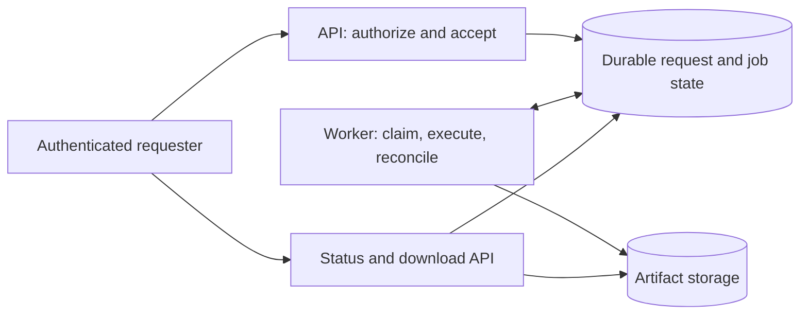
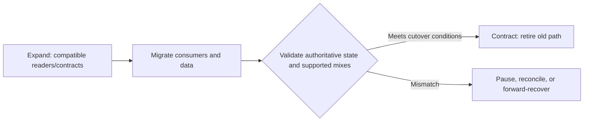

# Architecture Plan Casebook

**Read when:** a substantial plan needs a concrete example of how architectural drivers become decisions, ordered work, and falsifiable acceptance evidence. These scenarios are illustrative, not templates to copy into unrelated systems.

## Example A: Greenfield Durable Report Jobs

**Request:** "Users should request a report, leave, then download it later. Expect hundreds of reports per day; keep costs low."

### Drivers and uncertainties

| Question | Grounded requirement | Still unknown |
| --- | --- | --- |
| User outcome | Accept work, expose progress, permit authorized download | Artifact type, retention |
| Invariant | Only the correct user/tenant accesses a report; a repeated request must not cause an unintended duplicate business effect | Whether generating the report itself is idempotent |
| Workload | Hundreds per day, at most a rough average | Bursts, processing duration, size, memory |
| Operational constraint | Low ongoing cost | Recovery objective and availability promise |

Do not invent a concurrency target from the daily average. Determine service time and peak arrivals before claiming a single worker is sufficient or proposing a cluster.

### Candidate architecture

- The API establishes identity and authorization and durably records work **before** acknowledging acceptance.
- The durable job record owns status and stable operation identity; the worker owns execution and recovery.
- Artifact storage holds bytes; the read path still enforces current object/tenant access.
- The user sees truthful state, including a recoverable failure. A status page cannot substitute for actual recovery logic.

**Alternative:** introduce a distributed message broker. Reject it initially unless the observed arrival pattern, delivery requirements, or isolation constraints justify another operational component. A database-backed queue may be enough, but only if its concurrency and claiming semantics are proven in the chosen storage engine.

### Challenge with feasible failure schedules

| Failure schedule | Question the design must answer | Suitable evidence |
| --- | --- | --- |
| Worker dies after claim | Can another worker or restarted process recover without permanent "running" state? | Forced termination and lease/recovery test |
| Artifact committed; acknowledgement lost | Can repetition corrupt state or create duplicate billable effects? | Inject lost acknowledgement; check durable effect identity |
| Two workers race for the same claim | Who atomically selects the owner, and can a stale claimant commit later? | Controlled conflicting schedule |
| Caller changes tenants before download | Is authority checked on the actual download? | Rejected cross-tenant request via real entry point |

Do not claim exactly-once processing because a framework or broker offers an exactly-once feature. Identify the effect actually protected.

### Ordered implementation plan

1. Define state transitions and operation identity. Acceptance: legal and rejected transitions have independent tests.
2. Implement durable acceptance with authorization. Acceptance: accepted response points to committed work, and rejected callers leave no work.
3. Implement worker claiming, execution and recovery. Acceptance: interruption and duplicate-claim schedules preserve state.
4. Implement status and artifact access. Acceptance: correct user retrieves; other tenant cannot.
5. Run representative performance and recovery checks. Record actual measurements, environment and uncertainty. Add another worker or broker only if evidence calls for it.

This is more executable than "Use Redis/Celery for scalable background jobs" because it names contracts and the specific ways the proposed architecture could be wrong.

## Example B: Brownfield Content-Schema Change

**Request:** "Add a canonical subtitle to an existing CMS-backed website, visible in drafts and on the published page."

First inspect the existing schema, draft retrieval path, component props, any fallback/title behavior, builds, and consumers. Assume a "subtitle" field exists somewhere only when the repository shows it.

The *same value* may pass through schema, CMS editor, preview response, static build and presentation. That fan-out is not a design defect; separately defined subtitle defaults in each layer are.

**Candidate decision:** the content schema owns whether subtitle is optional; the content transformation defines one fallback if a fallback is required. Editors and renderers display the resolved content without reinventing the policy.

**Relevant changes and checks:**

| Step | Owning boundary | Rejection evidence |
| --- | --- | --- |
| Establish schema/type | Content contract | Unexpected value or absent optional field is handled deliberately |
| Update draft read and publish transforms | Preview/build data boundary | A draft subtitle appears only in authorized previews; published data remains unchanged until publication |
| Render content | UI consumer | Both absent and present subtitle cases are correct, including accessibility/layout obligations |
| Verify output | Built artifact and content preview | The delivered page and draft path, not only source types, show the intended distinction |

If current published documents lack the field, choose the fallback or migration before assuming everything will have it. Do not silently make a required field retroactive in an incompatible schema.

## Example C: Hybrid Storage or API Replacement

**Request:** "Replace an existing writer with a new service while old clients and deployed instances may remain active."

Define the compatibility contract *before* designing deployment steps:

| | Old writer | New writer |
| --- | --- | --- |
| Old reader | Existing known combination | Must be supported or explicitly prohibited |
| New reader | Must be supported or explicitly prohibited | Intended final combination |

A plan should say which combinations will actually coexist, who owns authoritative writes, and whether the old system can continue accepting traffic. The table does not promise all four combinations work.

**Hard question:** after writing in the new representation, can the previous version still read the state? If not, rolling back code may be unsafe even if the deployment tool offers a rollback button.

Define checkpoints: snapshot/backup and restoration evidence where justified, backfill repeatability, mismatch measurement, remaining old traffic, deployment order, and removal of temporary compatibility code. Distinguish rollback from forward recovery when irreversible business effects are involved.

## What a Finished Plan Proves—and Does Not

A plan should leave an implementer able to state the component owner, contract, dependency order, and check that rejects each important wrong outcome. It should mark evidence **observed**, **assumed**, or **to be established**.

A plan is not itself evidence that tests passed, the load target was met, a migration can be rolled back, or a new architecture is secure. For high-risk unknowns, propose a bounded experiment with a clear decision consequence; for routine choices, stop without ceremony.
