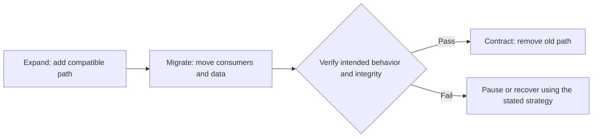

# Integration and Migration

**Read when:** new and existing components, APIs, schemas, data stores, or deployments need to coexist, migrate, or cut over.

## Establish the Transition Contract

List producers and consumers, current and proposed data contracts, supported versions, authoritative writers, deployment units, and failure/rollback responsibilities. State whether old/new versions may run simultaneously and how long that coexistence is actually needed.

Distinguish a replacement from an additive integration. Do not introduce dual writes, synchronization, or a compatibility shim without a concrete purpose and an end condition.

## Prove the Coexistence Contract

For a rolling change, enumerate the old and new readers and writers that may actually run together. Do not assume deployment is atomic across mobile clients, browser caches, workers, databases, and separate repositories.

| Combination | Question |
| --- | --- |
| Old reader + old writer | What currently works and what evidence proves it? |
| Old reader + new writer | Can the old reader consume newly written state without misinterpretation? |
| New reader + old writer | Can new code handle old fields and missing data during rollout? |
| New reader + new writer | Does the intended final contract satisfy all affected behavior? |

Unsupported mixes must be prohibited by the deployment plan, not silently ignored. Where zero downtime is required, verify that every combination that can actually occur is supported.

## Prefer an Explicit Transition

For changes requiring mixed-version coexistence, **expand → migrate → contract** is useful, not
universal. If every affected client and writer can be stopped or upgraded atomically within an approved
downtime window, a controlled cutover may be safer and simpler. Choose by actual compatibility,
integrity, recovery and operational constraints.

- **Expand:** allow the current consumers to keep functioning while a new contract is introduced. Compatibility is a deliberate decision, not an invitation to keep both paths forever.
- **Migrate:** change consumers in a dependency-aware order; backfill or reconcile data, and measure mismatches or remaining old usage.
- **Verify:** check real producer-consumer combinations, data integrity, operational effects, and any promised no-downtime guarantee.
- **Contract:** remove obsolete writers, readers, config, flags, and documentation after explicit cutover conditions are met.

## Address Irreversible Effects

Plan the **source of truth during transition** explicitly. If a backfill races with live writes,
identify the ordering, checkpoint, replay/delta or conflict policy, and the validation query that
would reveal divergence. If the old path still writes, decide how writes are fenced or reconciled
before the new path becomes authoritative.

Database rollback does not undo externally committed payments, emails, or side effects. For non-atomic distributed operations, identify stable operation identity, deduplication, reconciliation, or compensation at the owner of the effect.

If the old system and new system can both write, specify conflict resolution and when ownership transfers. Avoid unbounded bidirectional synchronization. A cutover without a trustworthy source of truth can corrupt data even when every service remains available.

## Make the Plan Executable

State: preconditions; checkpoints; migration script properties such as idempotency and restartability where relevant; validation queries; release order; rollback versus forward-fix feasibility; observation windows; and the removal condition for temporary bridges.

Do not promise zero downtime without a verifiable deployment and state-transition design. Where rollback is impossible after a data-format or business-effect change, say so and choose a safe forward-recovery strategy.

**Common migration failure:** adding the new read path, copying historical records, and switching
traffic while new writes still land in the old store. A correct migration must explain how live
writes are captured or stopped and how the final reconciliation proves no committed write was missed.

If the chosen strategy introduces temporary bridges, give each an owner and retirement condition.
Do not invent bridges only to match a staged-migration example. Deploying the new system alone does not
prove that an old system can be removed.

## Example: API Replacement

Before redirecting existing clients, establish compatibility for old and new request/response shapes, decide the source of truth for writes, check versioned clients, and instrument the remaining old traffic. Removing the previous service is a separate, evidence-driven cutover step.
