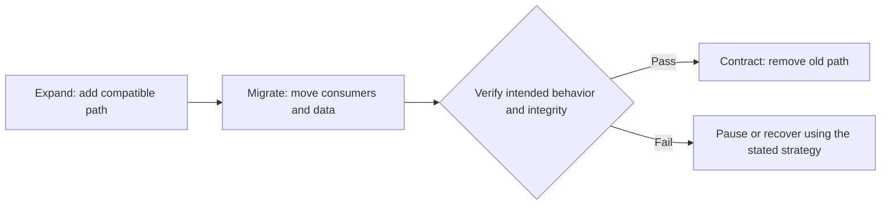

# Integration and Migration

**Read when:** new and existing components, APIs, schemas, data stores, or deployments need to coexist, migrate, or cut over.

## Establish the Transition Contract

List producers and consumers, current and proposed data contracts, supported versions, authoritative writers, deployment units, and failure/rollback responsibilities. State whether old/new versions may run simultaneously and how long that coexistence is actually needed.

Distinguish a replacement from an additive integration. Do not introduce dual writes, synchronization, or a compatibility shim without a concrete purpose and an end condition.

## Prefer an Explicit Transition

A common safe sequence is **expand → migrate → contract**, adapted to the supported deployment model.

- **Expand:** allow the current consumers to keep functioning while a new contract is introduced. Compatibility is a deliberate decision, not an invitation to keep both paths forever.
- **Migrate:** change consumers in a dependency-aware order; backfill or reconcile data, and measure mismatches or remaining old usage.
- **Verify:** check real producer-consumer combinations, data integrity, operational effects, and any promised no-downtime guarantee.
- **Contract:** remove obsolete writers, readers, config, flags, and documentation after explicit cutover conditions are met.

## Address Irreversible Effects

Database rollback does not undo externally committed payments, emails, or side effects. For non-atomic distributed operations, identify stable operation identity, deduplication, reconciliation, or compensation at the owner of the effect.

If the old system and new system can both write, specify conflict resolution and when ownership transfers. Avoid unbounded bidirectional synchronization. A cutover without a trustworthy source of truth can corrupt data even when every service remains available.

## Make the Plan Executable

State: preconditions; checkpoints; migration script properties such as idempotency and restartability where relevant; validation queries; release order; rollback versus forward-fix feasibility; observation windows; and the removal condition for temporary bridges.

Do not promise zero downtime without a verifiable deployment and state-transition design. Where rollback is impossible after a data-format or business-effect change, say so and choose a safe forward-recovery strategy.

## Example: API Replacement

Before redirecting existing clients, establish compatibility for old and new request/response shapes, decide the source of truth for writes, check versioned clients, and instrument the remaining old traffic. Removing the previous service is a separate, evidence-driven cutover step.
