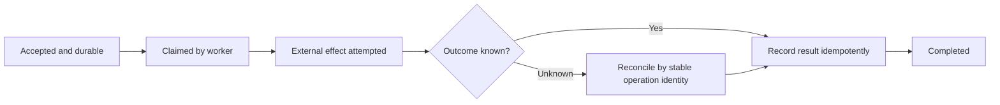

# State, Failure and Compatibility

**Read when:** changes affect lifecycles, concurrent state, persistence, retries or rolling data/API
transitions. Stateless edits do not need this workflow.

## Overview

**Core principle:** choose guarantees from the invariant and credible failure model. Neither a retry,
a database transaction nor a framework label proves the entire workflow correct.

## Make the Implicit State Model Visible

Name states, triggering events, guards, effects and allowed transitions. Identify invalid combinations
hidden by correlated flags, and what happens on duplicate, delayed or out-of-order events. State which
component owns a transition and which state is authoritative.

For a job, distinguish accepted, executing, effect committed and acknowledged. An acknowledgement lost
after commit is different from a job that never executed. Use an explicit state representation when
it removes ambiguity; no state-machine library, diagram or formal checker is required by this guide.

## Protect the Actual Consistency Rule

State the invariant across the relevant records and operations. Separate atomicity, isolation and
durability. A read followed by a write can race even inside a transaction; choose the supported lock,
checked version, constraint, atomic operation or isolation level that prevents the actual anomaly.

A useful probe schedules conflicting decisions deliberately rather than hoping a stress run reveals
them. Test both acceptance of a valid operation and rejection/preservation when the conflict occurs.

## Treat Unknown Outcomes Explicitly

A timeout or lost response does not establish whether a remote effect happened. Define retry
eligibility, stable operation identity, deduplication ownership and reconciliation. Protect the durable
effect with the duplicate decision where the system's storage semantics allow it. Local rollback
cannot undo an already-issued external action.

Distinguish broker delivery, handler execution and durable business effect; an exactly-once setting
in one layer is not an end-to-end guarantee. Define recovery or compensation for the real remaining
window instead of adding an unbounded retry loop.

## Give Resources and Authority a Lifetime

Track acquisition, ownership, release and failure/cancellation behavior for workers, subscriptions,
files, sockets and locks. A cancelled caller may leave remote work running. A paused worker may resume
after lease expiry; correctness may require the protected resource to reject stale ownership.

Use appropriate local clocks for elapsed time. Do not infer cross-machine ordering or current authority
from unrelated timestamps. Avoid synchronized derived state without a clear update/invalidation policy.

## Evolve Readers and Writers Together

List supported clients, stored versions, old/new readers and writers, deployment order and rollback
obligations. Decide whether a complete cutover is possible or a staged bridge is required. Verify the
mixed-version combinations the contract actually supports; do not retain compatibility paths forever
without an owner and end condition.

For replayable or derived data, identify authoritative input, checkpoints, retention and effects during
replay. Consider late/out-of-order data and personal-data deletion when affected. A successful all-new
installation does not establish upgrade, replay or rollback correctness.

## Completion

The intended transition and affected failure schedule preserve the named invariant, relevant recovery
is observable, and remaining unsupported schedules are stated. Add mechanisms only for a concrete
protection requirement; do not dismiss a serious integrity failure merely because it is uncommon.

## Worked Case: Durable Job with an Ambiguous External Effect

A worker accepts a certificate request, calls an external renderer or signer, writes a reference and acknowledges completion. The worker can die after the remote effect succeeds but before the local acknowledgement.

The diagram is conceptual. No framework, transaction boundary or number of states is mandated. The important invariant is that retry or recovery cannot create an unauthorized duplicate durable business effect.

Distinguish the **job ID** (one requested work item), **attempt ID** (one execution), and **effect ID/idempotency key** (one business operation) when the integration needs those identities. A retry may create another attempt while referring to the same business effect. A lease can avoid concurrent claims, but a stale worker may still resume; enforce fencing at the resource that accepts the effect when this race is consequential.

### Which Failures Actually Matter?

| Failure window | Potential wrong outcome | Discriminating check |
| --- | --- | --- |
| API acknowledges before durable accept | User receives job ID for work that was lost | Interrupt transaction/queue acceptance and inspect contract |
| Two workers claim | Both commit duplicated effect | Arrange conflicting claims in isolated test |
| Remote success, reply lost | Retry produces a second billable or signed result | Simulate ambiguous result and reconcile by stable identity |
| Worker crashes with lease | Job is forever "running" or stale worker later commits | Expire lease; test recovery and stale commit rejection |
| Client cancels | Partial external effect persists or state lies | Verify actual cancellation and terminal-state semantics |

Do not automatically add a global queue, distributed lock or outbox because the table mentions one. Choose the smallest mechanism that preserves the named invariant under credible schedules.

## Ownership of Authority During State Transitions

A principal may lose access between accepting work and executing it. Define whether permission is checked only at acceptance, at execution or at both, based on the actual contract and sensitive effect. Persisted job state is not necessarily perpetual authorization to act.

In multi-tenant systems, ownership and effect results should be tied to the correct tenant even during retries, queue replay and cache lookup. A secure request handler cannot compensate for a worker that trusts an unvalidated tenant identifier from the message body.

## Evidence Before Claiming Reliability

A passing happy-path worker test does not prove durability or failure recovery. Prefer focused schedules that force the relevant crash/retry boundary. A test with a mocked remote renderer proves only local coordination; a controlled integration test may be needed to establish real idempotency support. Label untested provider guarantees rather than assuming them.
