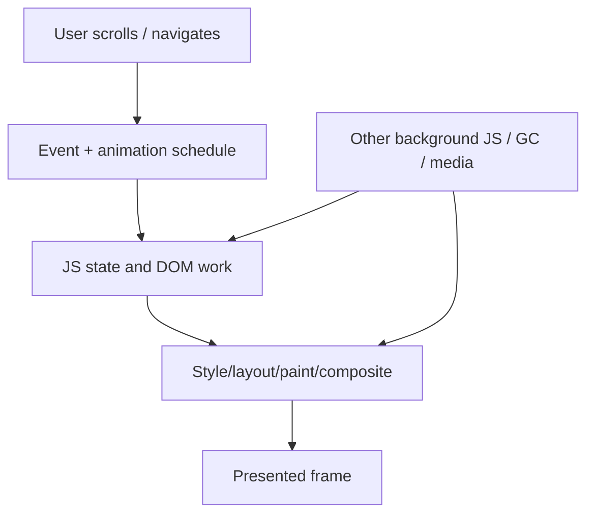

# Performance Casebook: Diagnose the Experience, Not the Label

**Read when:** a consequential performance plan needs worked hypotheses, a targeted measurement
strategy, or a counterexample to a common "optimization" shortcut. These scenarios are illustrative:
reuse the decision logic, not the stack, thresholds, or chosen remediation.

## Case 1 — Excellent Lighthouse Scores, Poor Scroll and Page Transitions

**Observed complaint:** a static, animation-rich site scores very well for LCP and lab checks but
feels frozen when scrolling or navigating between complex pages.

**What the score establishes:** useful evidence about the tested initial-load path. It does not
prove every runtime interaction, all animated frames, long-session behavior, browser extension,
mobile GPU or route transition is responsive.

**Candidate causes:** per-frame geometry reads and forced layout; competing animation controllers;
heavy filter/paint work; first-time section initialization; repeatedly loaded scripts on navigation;
or observers/listeners left alive from previous pages.

**Plan:** record the exact mobile/browser scenario; capture Chrome Performance trace and long
frames; compare section activation, scroll and route-change segments; attribute time to scripting,
layout/paint, compositor or another source. Test a targeted change in a safe copy, preserving required
animation and scrolling behavior.

**Poor shortcut:** remove the smooth scrolling library, disable animation, lazy-load every section,
and declare success from a score. This changes product behavior and can shift work into new hitches.

**Good evidence:** fewer overrunning frames in the same scroll interaction, identical visual
semantics and accessibility, no listener accumulation across navigation, and measured results on
the affected device class. A 100 Lighthouse score alone is insufficient.

## Case 2 — Server List Endpoint with Growing Response Time

**Observed complaint:** at 20 records the API is fast; at 2,000 records it becomes unresponsive.

**Hypotheses:** N+1 ORM lookups; remote pricing call per row; unbounded serialization; missing
pagination; CPU or GC pressure; lock wait; or concurrent request pool exhaustion.

| Evidence | Potential remedy | Counterfactual |
| --- | --- | --- |
| Query count proportional to rows | Join/prefetch/batch at domain boundary | Eager loading might overfetch or break row-level policy |
| Network requests proportional to rows | Provider batch/limited parallelism or contract change | A single batched request can increase latency on tiny lists |
| Huge output payload | Bounded output/pagination | Client may rely on stable ordering/cursor semantics |
| DB query wait dominates | Query plan/index/lock analysis | A new index can increase write overhead |
| High concurrency saturates pool | Bounded admission or capacity change | A larger pool may overload the database |

**Verification:** compare response latency distribution, query counts, error rate, resource use,
authorized data scope and actual records returned under representative datasets and concurrency.
A mock serializer benchmark does not show end-to-end improvement.

## Case 3 — Native App Launch Becomes Faster but Scroll Jank Increases

**Observed complaint:** a mobile app reduces first-screen work using lazy rows. Cold startup improves,
yet the list stutters when complex rows enter view.

**Reasoning:** work was delayed rather than removed. The next frame now pays image decode,
binding, rendering or state-work cost. The fix could be reduced per-row work, bounded prefetching,
stable item identity or a platform-supported optimization—not necessarily reverting to eager lists.

**Measurement:** cold/warm startup, frame pacing during a repeatable scroll, peak memory and
device class. Compare after repeated navigation and background/resume. Check reduced-motion,
large text and screen-reader behaviors where the UI supports them.

**Acceptance:** the interaction improves without introducing excessive memory, battery drain or
missing content. A test on one emulator is not evidence for all target phones.

## Case 4 — AI Responses Start Quickly but Become Expensive and Sluggish

**Observed complaint:** an assistant streams immediately yet a long response slows the UI and a
single conversation costs much more than expected.

**Potential causes:** rendering the entire transcript per token, repeated retrieval and prompt
construction, duplicate tool calls, stale input embeddings, unbounded context, model-side inference,
or expensive synchronous formatting on the client.

**Scope trace:** retrieval → context assembly → inference/stream → tool effects → client updates.
Measure first-useful-output and full completion separately; inspect stage cost and actual rendered
frame load.

**Remedy depends on evidence:** batch presentation updates without changing token order; reuse
verified document-version computations; bound tool loops; choose a cheaper model only if task
quality and safety remain acceptable. An unauthorized shared cache across tenants is never a
valid cost optimization.

**Verification:** compare token/resource cost, answer quality, allowed tool effects, p95 completion
and client responsiveness under realistic conversations, not a single short demo.

## Case 5 — Faster Average Backend Latency, Worse Tail Latency Under Load

**Observed complaint:** adding concurrency reduces mean service time in a local microbenchmark,
but p95 latency and errors rise during traffic bursts.

**Model the queue:** incoming demand, service time, admitted concurrency, pool sizes, retries,
downstream quotas, and waiting backlog. Increasing concurrency may produce lock contention, GC,
network queueing and timeouts. Retried requests can amplify overload, and a timeout may follow a
successful remote business effect.

**Candidate measures:** bounded concurrency, admission limits, prioritizing interactive work,
backpressure, adaptive resource capacity, or a changed data access pattern. Choose a control that
preserves promised durable work and fairness; dropping accepted payments is not an option.

**Evidence:** load test with realistic request mix, bursts, error rates, queue depth, p50/p95/p99,
downstream saturation and cost. Include a controlled failure/recovery scenario if relevant.

## Completion Rules

A case is **not** an instruction to add the suggested cache, worker, scheduler or framework.
Ask which hypothesis the observed evidence supports, whether the user contract is maintained, and
what counterfactual would make the remedy wrong. State unrun measurements and unsupported
environments explicitly.

The goal is economical, responsive software—not maximum microbenchmark score or adherence to
an optimization recipe.
