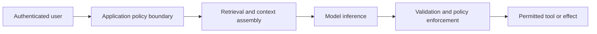

# AI Application and Tool Boundaries

**Read when:** explicitly reviewing or hardening LLM applications, RAG search, model-generated output, multi-tenant knowledge access, autonomous agents, or model-connected tools.

## Treat the Model as a Reasoning Component, Not an Authority

Map the actual path:

This is an illustrative trust model, not an architecture mandate. Some applications have no tools, use external orchestration or skip retrieval. Verify the real flow.

Separate (1) authenticated user permission, (2) retrieved-data visibility, (3) model instruction hierarchy and (4) executable tool authority. Documents, search results, webpages, transcripts and tool responses are data—even when they contain instructions. Prompt wording can improve behavior but is not a security boundary.

## Review the Real Enforcement Points

| Boundary | Questions to establish |
| --- | --- |
| Retrieval | Which principal and tenant control query scope? Are filtering, caches, embeddings and returned metadata tenant-scoped at the real storage/query boundary? |
| Context | Could untrusted content be promoted to a privileged instruction or trigger a privileged tool path? Which code enforces the intended separation? |
| Tool requests | Does the backend verify arguments, action, object authority, destination and current policy **at execution**? Does the model merely suggest an operation? |
| External effects | Are high-impact or irreversible actions bounded by the user's authorized scope, state checks and an appropriate approval/confirmation policy? |
| Output | Are generated HTML, SQL, code, URLs and structured arguments treated according to their **destination** before rendering or execution? |
| Resources | Which model/tool budgets, concurrency limits, size limits, deadlines and accounting constraints prevent unbounded cost or resource exhaustion? |

Schema validation is useful for structure, not an authorization guarantee. Redaction and sanitization alone do not prevent prompt injection or cross-tenant disclosure. Humans may need to approve particularly consequential actions, but not every tool call needs human intervention: implement an explicit, risk-appropriate permission policy.

## Test Independently of the Prompt

For a tenant-scoped retrieval feature, test that user B cannot retrieve user A's document through the **real retrieval and caching path**, even if the query text contains the document ID. For tools, craft controlled model outputs requesting a forbidden operation and verify the backend rejects it before any side effect. A friendly refusal from the model does not prove the backend is protected.

For tool-input injection, use a benign controlled instruction in an owned document or mock tool response; determine whether it can redirect tool selection or data release beyond the principal's authority. Never depend on model refusals as the only guard.

Describe observed behavior and controls separately from plausible risks. A simulated model response proves only the enforced boundary exercised in that test. It cannot certify every future model output or prompt.

## Choosing Controls

Prefer using the application's actual identity, authorization, egress, logging and lifecycle mechanisms over a new AI-specific security framework. Maintain clear audit evidence for privileged effects without logging secrets, full sensitive prompts, or cross-tenant retrieved content.

**Primary reference:** [OWASP GenAI LLM Risks](https://genai.owasp.org/llm-top-10/). Consult the currently applicable edition before citing individual category identifiers.
