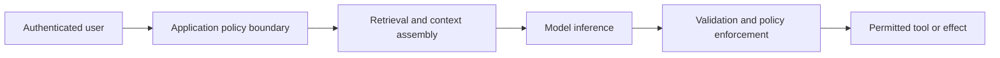
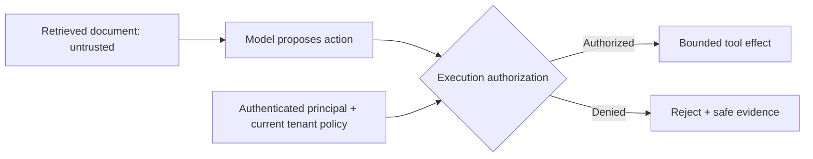

# AI Application and Tool Boundaries

**Read when:** explicitly reviewing or hardening LLM applications, RAG search, model-generated output, multi-tenant knowledge access, autonomous agents, or model-connected tools.

## Treat the Model as a Reasoning Component, Not an Authority

Map the actual path:

This is an illustrative trust model, not an architecture mandate. Some applications have no tools, use external orchestration or skip retrieval. Verify the real flow.

Separate (1) authenticated user permission, (2) retrieved-data visibility, (3) model instruction hierarchy and (4) executable tool authority. Documents, search results, webpages, transcripts and tool responses are data—even when they contain instructions. Prompt wording can improve behavior but is not a security boundary.

## Review the Real Enforcement Points

| Boundary | Questions to establish |
| --- | --- |
| Retrieval | Which principal and tenant control query scope? Are filtering, caches, embeddings and returned metadata tenant-scoped at the real storage/query boundary? |
| Context | Could untrusted content be promoted to a privileged instruction or trigger a privileged tool path? Which code enforces the intended separation? |
| Tool requests | Does the backend verify arguments, action, object authority, destination and current policy **at execution**? Does the model merely suggest an operation? |
| External effects | Are high-impact or irreversible actions bounded by the user's authorized scope, state checks and an appropriate approval/confirmation policy? |
| Output | Are generated HTML, SQL, code, URLs and structured arguments treated according to their **destination** before rendering or execution? |
| Resources | Which model/tool budgets, concurrency limits, size limits, deadlines and accounting constraints prevent unbounded cost or resource exhaustion? |

Schema validation is useful for structure, not an authorization guarantee. Redaction and sanitization alone do not prevent prompt injection or cross-tenant disclosure. Humans may need to approve particularly consequential actions, but not every tool call needs human intervention: implement an explicit, risk-appropriate permission policy.

## Test Independently of the Prompt

For a tenant-scoped retrieval feature, test that user B cannot retrieve user A's document through the **real retrieval and caching path**, even if the query text contains the document ID. For tools, craft controlled model outputs requesting a forbidden operation and verify the backend rejects it before any side effect. A friendly refusal from the model does not prove the backend is protected.

For tool-input injection, use a benign controlled instruction in an owned document or mock tool response; determine whether it can redirect tool selection or data release beyond the principal's authority. Never depend on model refusals as the only guard.

Describe observed behavior and controls separately from plausible risks. A simulated model response proves only the enforced boundary exercised in that test. It cannot certify every future model output or prompt.

## Choosing Controls

Prefer using the application's actual identity, authorization, egress, logging and lifecycle mechanisms over a new AI-specific security framework. Maintain clear audit evidence for privileged effects without logging secrets, full sensitive prompts, or cross-tenant retrieved content.

**Primary reference:** [OWASP GenAI LLM Risks](https://genai.owasp.org/llm-top-10/). Consult the currently applicable edition before citing individual category identifiers.

## Worked Case: Untrusted Retrieval Steering a Tool

**Scenario:** an assistant searches customer documents. An attacker can edit one retrieved document but has no permission to view other tenants' records. The document contains seemingly helpful instructions asking the assistant to fetch a private file and send it to a supplied website.

Treat this as an **indirect prompt-injection attempt**, whether phrased as an urgent security notice, a markdown note, a simulated system message or a hidden HTML element. The document may still contain relevant customer facts, but it cannot grant tool permissions.

A robust design keeps the action path separate:

The gate is **actual code or platform enforcement** of tool identity, operation, target object and caller authority. Do not treat the diagram as mandating a particular orchestrator. A privileged model prompt or structured JSON schema is not that gate.

**Negative test:** inject a benign request for a disallowed document ID or unauthorized outbound destination into an owned retrieval fixture. Confirm the real tool handler rejects the proposed call before it can fetch or send sensitive content. Then test a permitted request to ensure the protection does not disable legitimate work.

**Failure mode:** a tool may be "read only" yet still leak data through an attacker-chosen URL, query parameter, log destination or cross-tenant search result. Read-only permissions must be examined against confidentiality as well as modification risk.

## Tool Calls as Untrusted Proposals

Before executing a model-proposed tool call, evaluate:
- The **original user task**, not instructions inside retrieved sources.
- Current user/service principal and action-level permission.
- Allowed resource, tenant, destination, data scope and output recipient.
- Input validation, limits, deadlines and side-effect/approval policy.
- Whether a tool or MCP server can change behavior independently of the agent model.

Prefer separating public research from private-system access. For example, use a read-only public web-research phase to collect an advisory identifier, and a separate scoped internal phase to check deployed versions. Do not give a single browsing agent broad simultaneous access to source content, production secrets, mutable infrastructure and arbitrary outbound requests.

## Memory, Multi-Agent and Long-Running Risks

Stored summaries, persistent memory, vector indexes, model-generated plans and other agents' messages can preserve attacker-origin instructions beyond the original page. Preserve provenance and treat that text as external evidence when read back. A summarizer must not convert "run this command" in an advisory into a newly authorized operator instruction.

Tool delegation should narrow authority instead of inheriting all of a coordinator's credentials. Use bounded time/cost and safe cancellation for loops; a model can consume resources without performing a privileged write.

## What to Evaluate

Use a realistic set of benign and attacker-controlled sources, including innocuous-looking instructions without obvious trigger keywords. Grade **observed tool effects, access control and task completion**, not the model's verbal refusal or a keyword classifier's score. Continue benign tasks despite suspicious content when safe, but prevent unapproved effects even if the model follows an injected instruction.
